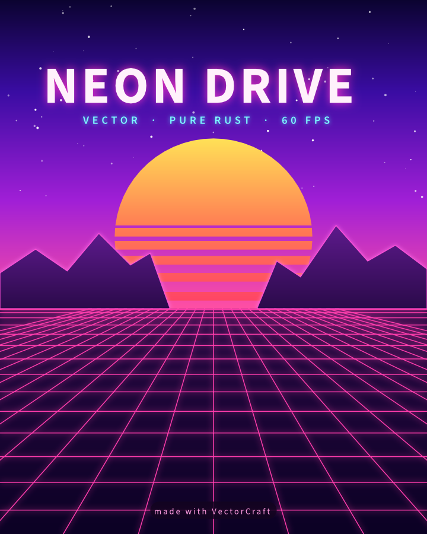
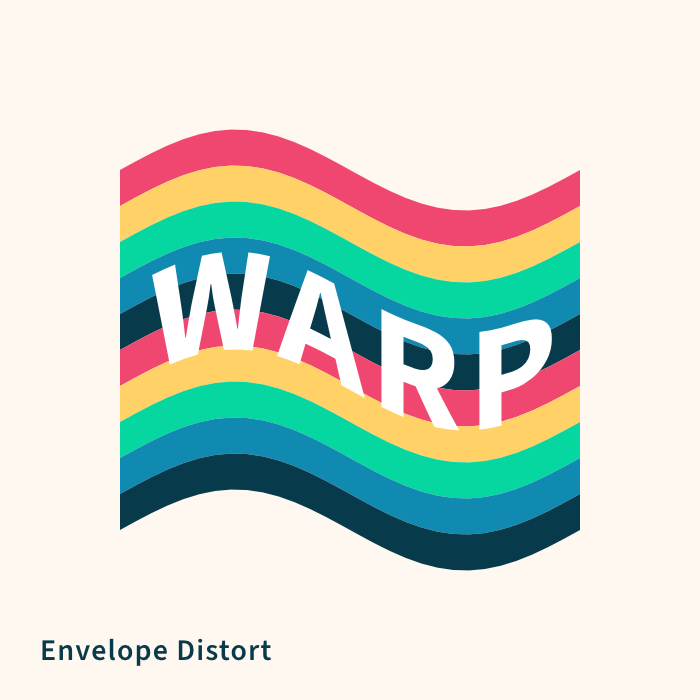
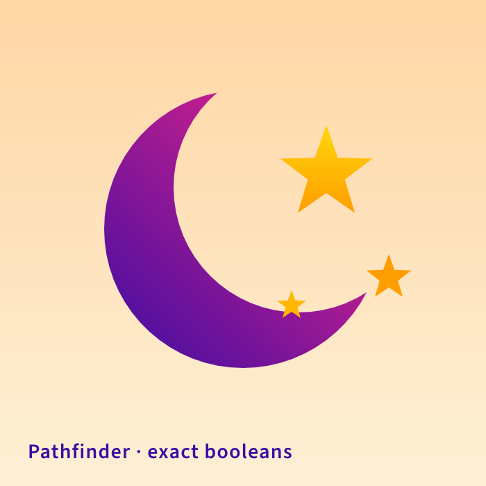

<p align="center">
  <a href="#vectnor">
    <picture>
      <source media="(prefers-color-scheme: dark)" srcset="assets/brand/logo-inverse.svg">
      
    </picture>
  </a>
</p>

<h1 align="center">Vectnor</h1>

**Developer and maintainer:** Appaji Ambarisha (`@appajid`), from 2026-10-12.
**Repository policy:** keep [appajid/vectnor](https://github.com/appajid/vectnor) private.

<p align="center">
  <b>Vector illustration; an open-source, clean-room reimplementation of Adobe Illustrator, rebuilt in pure Rust.</b>
</p>

<p align="center">
  A fast, open-source, clean-room take on the Adobe Illustrator workflow. It runs natively on
  macOS, Windows, Linux and FreeBSD, and in the browser via WebAssembly.
</p>

<p align="center">
  
  
  
  
  
</p>

<br>

<p align="center">
  <a href="#made-in-vectnor">Made in Vectnor</a> ·
  <a href="#why-vectnor">Why Vectnor</a> ·
  <a href="#quick-start">Quick start</a> ·
  <a href="#status">Status</a> ·
  <a href="#downloads">Downloads</a> ·
  <a href="#license-and-credits">License</a>
</p>

## Made in Vectnor

Every piece below was built entirely through Vectnor's command API, the same one the MCP server
exposes to agents, and exported by Vectnor's own renderer. The source files are in
[`examples/`](examples).

<table>
<tr>
<td width="50%" valign="top">
  
  <p align="center"><sub><b>Neon Drive</b>: synthwave poster with glowing type and grid</sub></p>
</td>
<td width="50%" valign="top">
  
  <p align="center"><sub><b>Dusk</b>: gradient sky, glowing sun, layered mountains</sub></p>
</td>
</tr>
<tr>
<td colspan="2" valign="top">
  
  <p align="center"><sub><b>Live Blends</b>: 70 steps, smooth colour, editable spines</sub></p>
</td>
</tr>
<tr>
<td width="50%" valign="top">
  
  <p align="center"><sub><b>Radial Repeat</b>: a live mandala</sub></p>
</td>
<td width="50%" valign="top">
  
  <p align="center"><sub><b>Envelope Distort</b>: striped type warped into a flag</sub></p>
</td>
</tr>
<tr>
<td width="50%" valign="top">
  
  <p align="center"><sub><b>Gradient Mesh</b>: shaded spheres</sub></p>
</td>
<td width="50%" valign="top">
  
  <p align="center"><sub><b>Pathfinder</b>: a crescent and stars from exact booleans</sub></p>
</td>
</tr>
</table>

## Why Vectnor

- **Familiar.** Illustrator's layout, tools, menus, panels and shortcuts: the Pen, Direct Selection,
  Pathfinder, Smart Guides, Appearance, Swatches, Layers and more. You already know how to use it.
- **Fast.** Multithreaded SIMD rendering off the UI thread. 20,000 shapes render in about 27 ms at
  full retina resolution while the interface stays at 120 fps.
- **Robust.** Exact curve booleans (no "cannot perform operation"), unlimited undo via structural
  sharing, and property-tested file round trips.
- **Open.** A documented native format (`.vcnr`, JSON), first-class SVG, PDF (and
  PDF-compatible `.ai`) import and export, PNG/JPEG/WebP export, Export for Screens, and SVGZ,
  templates, GIF, TIFF and BMP on open.
- **Agent-native.** Every menu item, tool gesture, panel and dialog can be driven over a JSON
  control channel and an **MCP server**, so Claude and other agents can draw, edit and export the
  way a person does.
- **Everywhere.** One codebase for the desktop apps and the same UI in the browser.

## Quick start

```sh
cargo run --release -p vectnor                          # desktop app
cargo run --release -p vectnor -- examples/dusk-poster.vcnr
cargo run --release -p vectnor -- --control 7979        # + JSON control channel
cargo run --release -p vectnor-cli -- mcp               # MCP server (stdio)
cargo run --release -p vectnor-cli -- run --in examples/ribbons.vcnr --export out.pdf   # headless batch
cargo run --release -p vectnor-cli -- bench examples/neon-drive.vcnr                   # render timing
cargo xtask bundle                                        # dist/Vectnor.app (macOS)
cd apps/vectnor-web && trunk build --release            # web build → dist/web
cargo xtask ci                                            # fmt, clippy, tests, layering, wasm, vendor names
```

Japanese fonts come from [storytold/craft-fonts](https://github.com/storytold/craft-fonts), an optional
build input (releases always use it): `CRAFT_FONTS_DIR="$PWD/../craft-fonts" cargo run --release -p vectnor` (an absolute path).
Without it, Japanese text uses the installed system fonts. See [`docs/development.md`](docs/development.md#fonts-craft-fonts-optional-build-input).

On machines with two graphics processors, Vectnor renders on the power-saving (integrated) one by default on
Windows and macOS, and on the one the desktop runs on under Linux. To choose, use **Preferences › Performance ›
Graphics Processor** and restart. If a graphics processor can't show the window, Vectnor starts again on the
next one. To pick one when starting the app, set `WGPU_POWER_PREF=high` (or `low`), or `WGPU_ADAPTER_NAME` to part of
its name, such as `WGPU_ADAPTER_NAME=nvidia` (see [`docs/development.md`](docs/development.md#desktop-graphics-processor)).

On native Wayland, winit 0.30 does not deliver dropped files. To open an SVG, use File › Open;
to place artwork in the current document, copy and paste the file in a file manager; or run
under XWayland (`WAYLAND_DISPLAY= vectnor`) for file drag-and-drop
(see [`docs/development.md`](docs/development.md#linux-wayland-and-x11)).

On Linux under KDE Plasma 6.3 or later with Wayland, a drawing tablet's pen moves the cursor but Vectnor doesn't
respond to it yet (#491). Start the app under XWayland instead: `WAYLAND_DISPLAY= vectnor` (see
[`docs/development.md`](docs/development.md#linux-wayland-and-x11)).

### Use it from Claude Code and other agents

Register the MCP server with Claude Code:

```sh
claude mcp add vectnor -- /path/to/vectnor-cli mcp
```

To keep an agent to one project's files, give it folders to read and write (the same flags as PhotoCraft):

```sh
claude mcp add vectnor -- /path/to/vectnor-cli mcp --automation-read-root /work/project --automation-write-root /work/project
```

The details are in [`docs/mcp.md`](docs/mcp.md) and [`docs/control-protocol.md`](docs/control-protocol.md).

For the experimental, unsupported 64-bit Windows 7 build, see [Windows 7 instructions](docs/windows7.md).

## Status

The initial Vectnor import retains a known geometry test failure: `planar::tests::pieces_cut_out_of_their_inputs`. Formatting, workspace lint and the latest UI/WASM checks pass; full CI remains blocked by this recorded regression ([G11](docs/gaps.md#g11-correctness-bugs-in-core-tools)).

Renamed to **Vectnor** on 2026-10-12. Native documents use `.vcnr`.

Vectnor is under active development. [**ROADMAP.md**](ROADMAP.md) has the stage, the numbers by dimension
and what's next; [`docs/target-app-parity.md`](docs/target-app-parity.md) the full parity assessment and
[`docs/gaps.md`](docs/gaps.md) the ranked list of what's missing.

**Where we are (2026-10-10): alpha.** About 88% of Illustrator 2026's menu items, tools, effects and formats exist
(92.5% of menu items do something), feature depth is ~75%, and we estimate ~65% "ready for real work" for a mainstream illustrator (~62% against
all of Illustrator): everyday
vector illustration is close to usable: drawing and path tools,
Pathfinder and Shape Builder, paint, gradients, appearance and transparency, type with styles, threading and Hebrew/Arabic bidirectional layout, and
files (SVG, PDF and PDF-compatible `.ai` with PDF/X, EPS, DXF, EMF/WMF, raster formats, PSD out and PSD/PSB in as their merged image, Print, Package).
Affinity documents (`.af` from Affinity 3, `.afdesign`, `.afpub` and, by their content, `.afphoto` from Affinity 1 and 2) open
and place natively: layers, groups, artboards and pages, curves and shapes, fills, gradients and strokes, clipping
and masks, text and images, with what didn't come in (effects, adjustments, brushes, master pages…) listed in the
import warning; a file whose native data can't be read opens as its embedded preview, saying why. Vectnor
doesn't write Affinity files. Current `.af` validation includes 33 pinned files, native save/reload
and every-board SVG/PDF/PSD export, with fixes for Affinity 3 artboards, source-backed JPEGs and text runs.
[Scope and limits](crates/affinity/README.md); [source audit and remaining gaps](docs/affinity-validation.md).
The interface
speaks English, German, Japanese, Traditional and Simplified Chinese, Spanish, French, Italian, Russian and Ukrainian (and Czech and Brazilian Portuguese in the menus);
[localization-parity.md](docs/localization-parity.md) has the details.
The scores are self-assessed from our code against Illustrator's public documentation;
[target-app-parity.md](docs/target-app-parity.md#how-this-was-measured-2026-10-10) explains how far to trust them.

**What's missing:**
- reliable exchange of Illustrator's own `.ai` files (layer structure in real files; Illustrator's editing data isn't written);
- an interaction-fidelity pass covering every tool's modifiers and small behaviours;
- 3D and Materials beyond the initial live Revolve (Extrude & Bevel, Inflate, Rotate, materials);
- about half of the Photoshop-style raster effects (29 of 57 still missing) and the Effect Gallery;
- CJK composition for vertical type (vertical type itself has initial support, with a Japanese interface);
- scripting, and the rest of Variables (image and graph kinds, dataset import);
- generative AI features.

**Where we're going:** next is the interaction-fidelity pass, `.ai` files from real users and start-up stability,
alongside the raster-effects package; then type, the Illustrator 2026 additions and 3D. The ranked list is in
[`docs/gaps.md`](docs/gaps.md).

**Workspace:** `crates/{geom, color, doc, pathops, text, effects, three-d, trace, brush, render, svg, pdf, eps, cad, metafile, format, tools, engine, ui-egui, mcp, testkit}`
and `apps/{vectnor, vectnor-cli, vectnor-web}`. The egui frontend is its own crate, so
the UI can be swapped without touching the engine.

Agent and contributor rules (clean-room, the asset policy, no panics in shipped code, quality gates) are in
[`AGENTS.md`](AGENTS.md); [`docs/development.md`](docs/development.md#robustness-vectnor-never-crashes)
explains how Vectnor avoids crashing, and [`docs/releasing.md`](docs/releasing.md) how releases are built,
signed and published. Every bundled asset is listed with its licence in [`ASSETS.md`](ASSETS.md).

## Downloads

Build Vectnor locally with the commands above; platform packaging scripts are in `packaging/`.

`<ver>` in package names is the version number. Build the packages locally with `packaging/`; verify distributions against their `SHA256SUMS.txt`.

### Windows

| Build | Installer | Portable |
|---|---|---|
| x64 (64-bit Intel/AMD) | `vectnor-<ver>-windows-x64.msi` | `vectnor-<ver>-windows-x64-portable.zip` |
| arm64 (Snapdragon and other ARM PCs) | `vectnor-<ver>-windows-arm64.msi` | `vectnor-<ver>-windows-arm64-portable.zip` |
| x86 (32-bit) | `vectnor-<ver>-windows-x86.msi` | `vectnor-<ver>-windows-x86-portable.zip` |

Installers and executables are code-signed.

### macOS

| Build | File | Notes |
|---|---|---|
| App, universal (Apple silicon + Intel) | `vectnor-<ver>-macos-universal.dmg` | Signed and notarized |
| Command-line tool, universal | `vectnor-cli-<ver>-macos-universal.zip` | Signed and notarized |

### Linux

| Format | x86_64 | aarch64 (ARM64) | Notes |
|---|---|---|---|
| AppImage | `vectnor-<ver>-linux-x86_64.AppImage` | `vectnor-<ver>-linux-aarch64.AppImage` | Runs anywhere; updates itself with [AppImageUpdate](https://github.com/AppImageCommunity/AppImageUpdate) (`.zsync` files) |
| Flatpak | `vectnor-<ver>-linux-x86_64.flatpak` | `vectnor-<ver>-linux-aarch64.flatpak` | Sandboxed; `flatpak install --user <file>` |
| Debian/Ubuntu | `vectnor-<ver>-linux-x86_64.deb` | `vectnor-<ver>-linux-aarch64.deb` | |
| Fedora/RHEL/openSUSE | `vectnor-<ver>-linux-x86_64.rpm` | `vectnor-<ver>-linux-aarch64.rpm` | |
| Tarball | `vectnor-<ver>-linux-x86_64.tar.gz` | `vectnor-<ver>-linux-aarch64.tar.gz` | Unpack anywhere |

### FreeBSD

| Build | File |
|---|---|
| x86_64 | `vectnor-<ver>-freebsd-x86_64.tar.gz` |

### Web (WebAssembly)

| Build | File | Notes |
|---|---|---|
| Static site | `vectnor-web-<ver>.zip` | Runs in a modern browser; host it on any static server |

## License and credits

Vectnor is dual-licensed under [MIT](LICENSE-MIT) or [Apache-2.0](LICENSE-APACHE), at your option.
Required copyright and attribution notices are in [NOTICE](NOTICE).

Bundled fonts, icons, images and other assets keep their own open licenses; each one is listed
with its author, source and license in [ASSETS.md](ASSETS.md). Release builds also embed the
fonts of [craft-fonts](https://github.com/storytold/craft-fonts/blob/main/ATTRIBUTION.md) (Japanese,
Simplified Chinese and Arabic faces; SIL Open Font License 1.1).

The app icon (a teal-to-green V on a navy tile) is Appaji Ambarisha’s original AI-assisted artwork; its
palette and files are in [`assets/app-icon/`](assets/app-icon/README.md).
